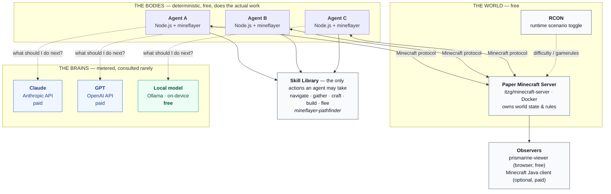
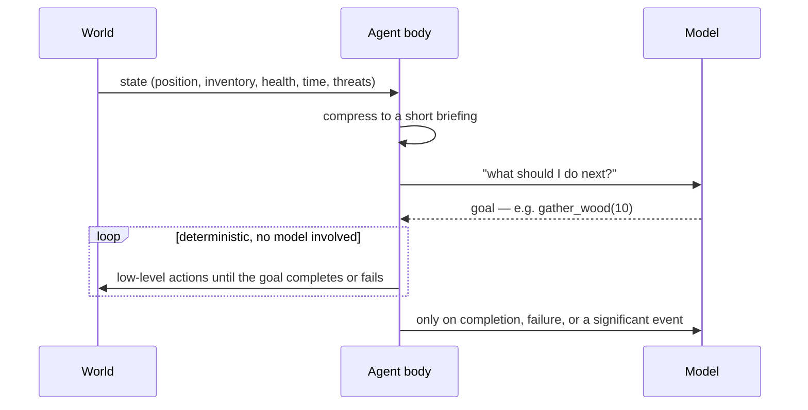

# multi-agent-experimentation

A testbed for running several AI agents in one shared environment — each driven by a different
model, including one that runs locally for free — and measuring what they cost, where they
cooperate, and where they get in each other's way.

Minecraft is the environment, but it is **not the point**. It was chosen because agent behaviour
is normally invisible: it happens in API calls and log files, and when it fails you get a stack
trace with no story attached. In a game world you can watch three agents walk into the same
forest and either coordinate or collide. Swap the environment for a codebase, a ticket queue, or
a data pipeline and everything else here stays the same.

---

## Architecture



**Only the dotted lines cost money.** Everything else — the world, the bodies, the skills — runs
locally for free, and that is where almost all of the work happens.

---

## The control loop

A game ticks 20 times per second; a model takes seconds to answer. So the model never touches
the controls. It picks a **goal**; deterministic code executes it.



This is the single most important design rule in the repo. Put the model in the control loop and
the agent is slow, expensive, and dead before it finishes thinking.

---

## Scenarios

The same world runs in two modes, flipped with one setting. They are not difficulty levels —
they test different things.

| Scenario | World | Question it answers |
|---|---|---|
| `sandbox` | Peaceful. No hostiles, no clock. Open-ended goal. | Can agents self-direct and stay coordinated with nothing forcing their hand? |
| `survival` | Hostile mobs, hunger, a hard deadline at nightfall. | Can agents plan under constraint and recover when the plan fails? |

The relaxed mode is the harder test — pressure supplies focus, an open goal does not. Toggling is
a single RCON call plus a swap of the goal given to the agents, so runs stay comparable.

---

## Software

| Component | What it does | Cost |
|---|---|---|
| [Docker](https://www.docker.com/) + Compose | Runs the server; keeps Java off the host | free |
| [itzg/minecraft-server](https://github.com/itzg/docker-minecraft-server) | Container image — EULA, version pinning, RCON, config via env | free |
| [PaperMC](https://papermc.io/) 1.21.x | The Minecraft server itself. Chosen over vanilla for chunk/entity performance — every bot is a chunk-loading epicentre | free |
| Java 21 | Runs Paper — **inside the container only** | free |
| [Node.js](https://nodejs.org/) 25 + TypeScript | The agent processes | free |
| [mineflayer](https://github.com/PrismarineJS/mineflayer) | Independent implementation of the Minecraft protocol. Not Minecraft — no client, no licence needed | free |
| [mineflayer-pathfinder](https://github.com/PrismarineJS/mineflayer-pathfinder) | Navigation, so the model never steers | free |
| [prismarine-viewer](https://github.com/PrismarineJS/prismarine-viewer) | Renders a bot's world model in a browser tab | free |
| [Ollama](https://ollama.com/) | Runs an open model on-device. OpenAI-compatible API, so it shares an adapter with GPT | free |
| [Anthropic API](https://docs.claude.com/) | Claude as a brain | usage-based |
| [OpenAI API](https://platform.openai.com/) | GPT as a brain | usage-based |
| Minecraft Java Edition | **Optional.** Only needed to walk around the world yourself | ~$30 one-time |

### Why no Minecraft purchase is required

"Minecraft" is two separate pieces of software. The **server** is free and always has been. The
**client** — the graphical game — is the part that costs money. Bots need neither: mineflayer
speaks the protocol directly and contains no Mojang code. With `ONLINE_MODE=FALSE` the server
skips the ownership check, which is a supported setting intended for LAN and development use.

Buy the client only when you want your own eyes in the world. `prismarine-viewer` covers watching
until then.

---

## Status

Early. Scaffolding in progress — see commit history.

## Running it

> Requires Docker running, Node 25+, and (for the free agent) Ollama installed.

```bash
cp .env.example .env        # API keys optional — the local agent needs none
docker compose up -d        # Paper server on :25565
npm install
npm run agent -- --scenario sandbox --brain scripted   # no model; proves the loop
```

Never commit `.env`. This repo is public.

## Licence

MIT
