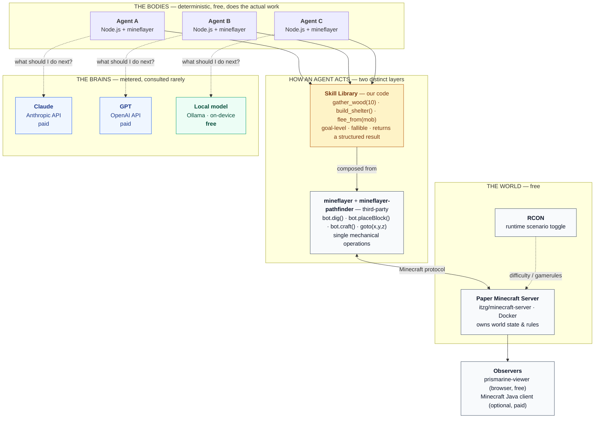
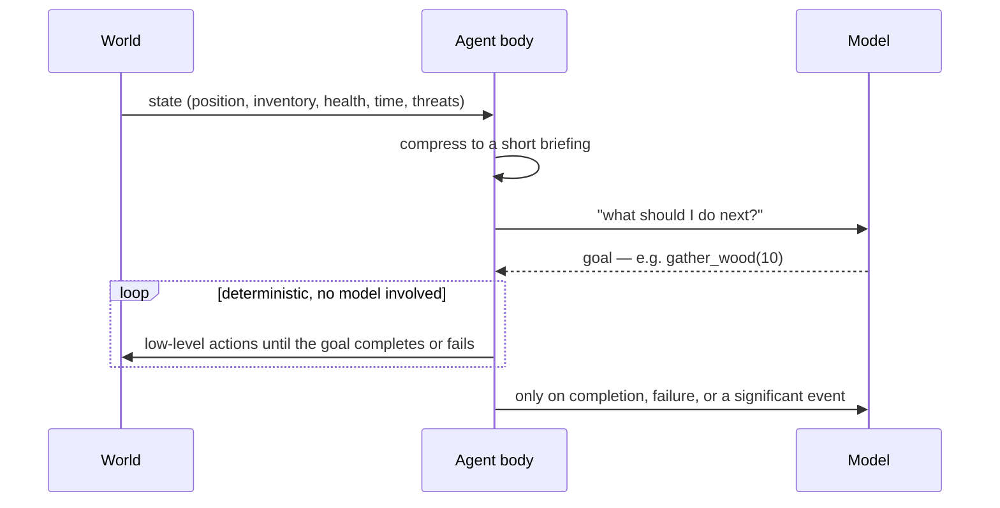

# multi-agent-experimentation

A testbed for running several AI agents in one shared environment — each driven by a different
model, including one that runs locally for free — and measuring what they cost, where they
cooperate, and where they get in each other's way.

Minecraft is the environment, but it is **not the point**. It was chosen because agent behaviour
is normally invisible: it happens in API calls and log files, and when it fails you get a stack
trace with no story attached. In a game world you can watch three agents walk into the same
forest and either coordinate or collide. Swap the environment for a codebase, a ticket queue, or
a data pipeline and everything else here stays the same.

## Quick start

You need Docker and [Ollama](https://ollama.com/) running, and Node 25+. No Minecraft purchase and
no API key are needed: the free local model plays on its own.

```bash
./start.sh --check          # says what's missing, starts nothing
./start.sh                  # Minecraft server, minds panel and one agent per available brain
```

A run lasts one in-game day (about 20 minutes) and then the agent stops by itself. For a
two-minute try, use `./start.sh --ticks 2400`. `./start.sh --help` lists every option.

Then watch:
- **The agent's view:** http://localhost:3007, a 3D view of the world as the Ollama agent sees it.
- **Its decisions:** http://localhost:3010 (the minds panel), with what it saw, chose and why for every step.

```bash
npm install                 # once, for the report and experiment scripts
npm run report              # how each run went: outcome, decisions, tokens, cost
npm run summary             # rebuild the newest run's report on how the agent behaved (every run writes one)
./stop.sh                   # stop the agents (./stop.sh --all also stops Minecraft)
```

To add Claude or GPT, put their keys in `.env` (`cp .env.example .env`). They start only when a
key is set. Set a monthly spend limit in each provider's console as well.

---

## How it works

The rule the whole repo follows: **the model decides, the code does.**

- A Minecraft server (in Docker) is the shared world.
- Each **agent** is a Node.js process that joins the world as a player.
- When an agent needs to choose, it builds a short summary of its situation (an *observation*)
  and asks its **brain**, a model, which **skill** to run next, such as `gather_wood(10)` or
  `build_shelter()`.
- The skill is our code. It does the work, which can take many seconds of game time, and reports
  back in plain words, such as "need 2 more planks — gather wood first".
- The model only chooses between skills. It never steers.

The brain can be fixed rules (`scripted`, the control), a free local model (Ollama), or a paid
one (Claude, GPT, Gemini, Grok and others through one interface). Every decision is logged, with
the exact prompt and answer, so any run can be replayed and costed later.

## Documentation

| Read | For |
|---|---|
| [docs/skills.md](docs/skills.md) | Every skill an agent can use, how it works and how it fails |
| [docs/communication.md](docs/communication.md) | How agents see and talk to each other, and the three stances |
| [docs/experiments.md](docs/experiments.md) | Running a fair comparison and reading the report |
| [docs/results/](docs/results/) | What the experiments so far have found |
| [docs/limitations.md](docs/limitations.md) | What is untested, missing or rough |
| [docs/next-steps.md](docs/next-steps.md) | Where things stand, what's open, and setting up a new machine |
| [CLAUDE.md](CLAUDE.md) | Conventions for changing the code |

---

## Status

**MVP.** The full loop works with the free local model and the scripted baseline:
- one or several agents in a shared world;
- preset goals, checked by code: tools, shelter, an outpost that has to last the night, iron, diamond (not yet met in a full run), and a team goal;
- memory and stance settings;
- comparison batches with fresh worlds;
- a report with confidence intervals;
- a panel that shows every decision.

Claude models (Haiku, Sonnet, Opus) have run single tests and team runs, but no comparison batch
yet. Several agents can work as a team on a shared goal and hand each other items (`team-camp`).

**What we've found so far** (free local model, details in [docs/results/](docs/results/)):
- Fixing the skill code mattered more than anything about the model.
- Full conversation memory works best. A self-written plan makes this small model *worse*: it
  follows its own stale plan into loops.
- Small models often claim success they haven't reached. The harness now refuses a premature
  "done" and says what is missing.
- The long outpost goal (tools, shelter, survive the night) is beyond this model so far: 1 of 18
  model runs, against 5 of 6 for the baseline in the last two batches. It makes the tools but rarely
  builds the shelter.

What isn't done or isn't tested is listed in [docs/limitations.md](docs/limitations.md).

---

## Running experiments

```bash
CONDITIONS="scripted ollama:none ollama:full" GOALS="tools shelter" scripts/batch.sh b10 3 12000 sandbox
STANCE=competitive scripts/team.sh t2 "qa=ollama:full qb=ollama:full"
npm run report -- --by condition --batch b10
```

The first line runs one agent per world across several conditions. The second puts several agents
in one world. The third summarises a batch, one row per condition, with success rates and 95%
intervals. Everything is explained in [docs/experiments.md](docs/experiments.md).

---

## Details

### Architecture



**Only the dotted lines cost money.** Everything else runs locally for free.

The amber box is the part we write. Mineflayer supplies *primitives* — break one block, place one
block, walk to a coordinate. A **skill** is a goal: `gather_wood(10)` must find a reachable tree,
break every log in the trunk, collect the drops, widen its search if there are none, give up
cleanly if a mob interrupts, and report back `{status, reason}` so the model can replan. That gap
is where the engineering lives, and it is what lets the model say "gather wood" instead of
issuing four hundred individual dig commands.

Every skill, what it does, and how it fails is listed in [docs/skills.md](docs/skills.md). How agents
talk to each other is in [docs/communication.md](docs/communication.md).

---

### The control loop

A game ticks 20 times per second; a model takes seconds to answer. So the model never touches
the controls. It picks a **goal**; deterministic code executes it.



This is the single most important design rule in the repo. Put the model in the control loop and
the agent is slow, expensive, and dead before it finishes thinking.

---

### Scenarios

The same world runs in two modes, flipped with one setting. They are not difficulty levels —
they test different things.

| Scenario | World | Question it answers |
|---|---|---|
| `sandbox` | Peaceful. No hostiles, no clock. Open-ended goal. | Can agents self-direct and stay coordinated with nothing forcing their hand? |
| `survival` | Hostile mobs, hunger, a hard deadline at nightfall. | Can agents plan under constraint and recover when the plan fails? |

The relaxed mode is the harder test — pressure supplies focus, an open goal does not. Toggling is
a single RCON call plus a swap of the goal given to the agents, so runs stay comparable.

#### What is held fixed, and what is not

- **Terrain is fixed.** The world is generated from a fixed seed (`SEED` in `compose.yaml`), and
  `scripts/batch.sh` gives every run a freshly regenerated copy, so no run inherits another's
  felled trees, holes or inventory.
- **The start point varies a little.** New players appear at a random spot within
  `spawnRadius` (Minecraft's default, 10) of the world spawn. Across batches b1–b5 (78 runs)
  every agent started inside one 20 × 21 block area (x −8…11, z 23…43). That is close enough to
  share the same surroundings, but not identical: some starts are next to oak trees and others
  next to dark oak. Treat small differences between conditions with that in mind.
- **The game does not pause while a model thinks.** The world keeps ticking during every model
  call, so ticks-to-goal measures decision quality and response speed together, which is
  deliberate. Each call's duration is logged (`calls[].ms`), each decision's time including
  retries (`decisionMs`), and `npm run report` shows the median, P90 and retry count per run.

---

### Software

| Component | What it does | Cost |
|---|---|---|
| [Docker](https://www.docker.com/) + Compose | Runs the server; keeps Java off the host | free |
| [itzg/minecraft-server](https://github.com/itzg/docker-minecraft-server) | Container image — EULA, version pinning, RCON, config via env | free |
| [PaperMC](https://papermc.io/) 1.21.x | The Minecraft server itself. Chosen over vanilla for chunk/entity performance — every bot is a chunk-loading epicentre | free |
| Java 21 | Runs Paper — **inside the container only** | free |
| [Node.js](https://nodejs.org/) 25 + TypeScript | The agent processes | free |
| [mineflayer](https://github.com/PrismarineJS/mineflayer) | Independent implementation of the Minecraft protocol. Not Minecraft — no client, no licence needed | free |
| [mineflayer-pathfinder](https://github.com/PrismarineJS/mineflayer-pathfinder) | Navigation, so the model never steers | free |
| [prismarine-viewer](https://github.com/PrismarineJS/prismarine-viewer) | Renders a bot's world model in a browser tab | free |
| [Ollama](https://ollama.com/) | Runs an open model on-device. OpenAI-compatible API, so it shares an adapter with GPT | free |
| [Anthropic API](https://docs.claude.com/) | Claude as a brain | usage-based |
| [OpenAI API](https://platform.openai.com/) | GPT as a brain | usage-based |
| Minecraft Java Edition | **Optional.** Only needed to walk around the world yourself | ~$30 one-time |

#### Why no Minecraft purchase is required

"Minecraft" is two separate pieces of software. The **server** is free and always has been. The
**client** — the graphical game — is the part that costs money. Bots need neither: mineflayer
speaks the protocol directly and contains no Mojang code. With `ONLINE_MODE=FALSE` the server
skips the ownership check, which is a supported setting intended for LAN and development use.

Buy the client only when you want your own eyes in the world. `prismarine-viewer` covers watching
until then.

---

### What start.sh does

```bash
./start.sh --scenario survival --goal shelter --ticks 12000   # options: ./start.sh --help
```

It checks Docker and Ollama, pulls the model if missing, starts the server, then the minds panel
(http://localhost:3010) and one agent per available brain (viewers on :3007 ollama, :3008 claude,
:3009 gpt). Claude and GPT start only if their key is set. Ollama stays on the host (Metal GPU);
containers reach it at `host.docker.internal:11434`. To join yourself, use Minecraft Java 1.21.1
at `localhost`.

#### On Linux, Windows, or an Intel Mac

Developed on an Apple Silicon Mac; other platforms are expected to work but are less tested.
Run `./start.sh --check` first; it checks the setup without starting anything.

| | Docker | Ollama (local model) | Notes |
|---|---|---|---|
| **Apple Silicon Mac** | Docker Desktop | `brew install ollama && brew services start ollama` | Fast (GPU via Metal) |
| **Linux** | Docker Engine | `curl -fsSL https://ollama.com/install.sh \| sh` | Fast with an NVIDIA/AMD GPU, slow on CPU only. **Ollama must listen beyond localhost** so containers can reach it: `start.sh` detects this and prints the fix (`OLLAMA_HOST=0.0.0.0`) |
| **Windows** | Docker Desktop (WSL2 backend) | Windows installer from ollama.com | Run `./start.sh` from a **WSL2** shell, not PowerShell. Enable WSL mirrored networking so WSL can reach Ollama at `localhost` |
| **Intel Mac** | Docker Desktop | as Apple Silicon | Slow: no GPU acceleration for the model |

Without a GPU, expect several seconds to half a minute per decision from the local model. Use a
non-thinking model (the default `qwen3:4b-instruct`): reasoning models are too slow for the
120-second decision timeout on CPU. Linux machines with an NVIDIA GPU can instead run Ollama in a
container: `docker compose --profile ollama-docker up -d ollama` (untested).

Manual path:

```bash
cp .env.example .env        # API keys optional — the local agent needs none
docker compose up -d        # Paper server on :25565
npm install
npm run agent -- --scenario sandbox --brain scripted   # no model; proves the loop
```

Never commit `.env`. This repo is public.

**Paid brains and credits.** `--budget-usd` (default $1.00) stops one run before it overspends, but
the real guard against a surprise bill is a monthly spend limit in the Anthropic and OpenAI
consoles — set one when you create a key. Each model agent makes one tiny call before joining the
world, so a bad key or an empty account stops it at startup with the provider's message. If credits
run out mid-run, the run ends as `brain unavailable` (no retries) and `npm run report` marks it, and
every other agent in that episode, as not comparable. Rate limits and overloads are retried with
backoff instead.

## Licence

MIT
