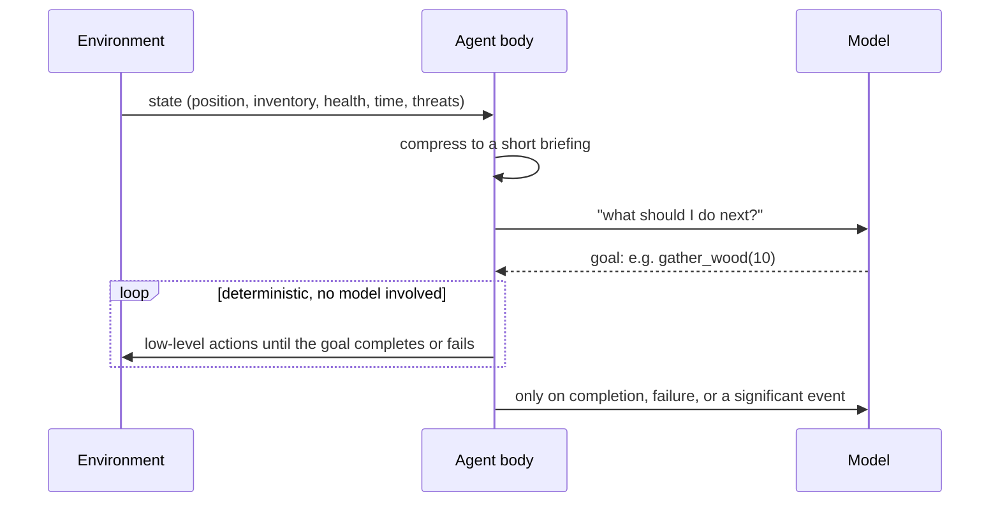
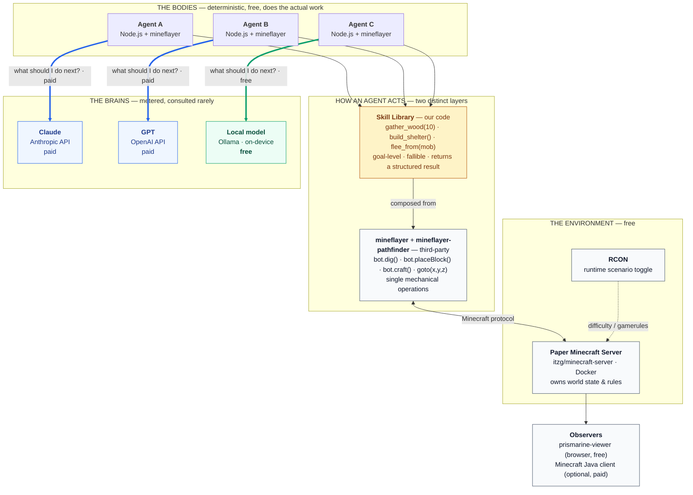

# multi-agent-experimentation

What do AI agents do when they are given a goal, a set of tools, and then left alone?

A short overview of the project is on [rrjamal.ca](https://rrjamal.ca/projects/multi-agent-experimentation).

**Contents**

- [The control loop](#the-control-loop)
- [What an agent is given](#what-an-agent-is-given)
- [What gets measured](#what-gets-measured)
- [Why this matters beyond the game](#why-this-matters-beyond-the-game)
- [Getting started](#getting-started): [prerequisites](#1-install-the-prerequisites) · [get the code](#2-get-the-code) · [check your setup](#3-check-your-setup) · [first run](#4-start-your-first-run) · [watch](#5-watch-it-work) · [results](#6-read-the-results) · [paid models](#7-add-paid-models-optional) · [your own experiments](#8-run-your-own-agents-and-experiments) · [stop](#9-stop)
- [Status](#status)
- [Documentation](#documentation)
- [Running experiments](#running-experiments)
- [Details](#details): [architecture](#architecture) · [scenarios](#scenarios) · [software](#software)
- [Licence](#licence)

This is a testbed for running autonomous agents **hands-off**. Each agent gets an outcome to reach
and a fixed set of tools to act with, and nothing else: no step-by-step instructions, no human
stepping in when it gets stuck. Several agents can share one environment, each driven by a
different model, including one that runs locally for free. We measure whether they reach the goal,
how they plan, how they recover when something fails, whether they work together, and what it all
costs.

**Minecraft is only the environment, and a convenient one.** It is free to run, it can be watched
as it happens, it is rich enough that goals take real planning, it keeps running while a model
thinks, and a fixed seed makes runs repeatable. None of that is the subject. The agents, their
tools, the control loop, the logs and the reports would stay the same if the environment were a
codebase, a ticket queue or a data pipeline.

## The control loop

The rule the whole repo follows: **the model decides, the code does.**

The environment moves on in real time (20 ticks a second); a model takes seconds to answer. So the
model is never in the control loop. It chooses a **goal**, a tool call such as `gather_wood(10)`
or `build_shelter()`, and deterministic code carries it out: it finds its own targets, retries,
gives up cleanly, and reports back in plain words ("need 2 more planks: gather wood first"). The
model is consulted again only when that goal succeeds, fails, or something important happens.



This is the most important design decision here. Put the model in the control loop and the agent
is slow, expensive, and overtaken by events before it finishes thinking. Keep it out, and the
same agent can work through a whole in-game day on a few dozen decisions. When an agent needs a new
ability, the answer is a new tool (deterministic code), not more consulting of the model.

## What an agent is given

- **A goal, stated as an outcome:** "Make a stone pickaxe, axe, sword and shovel, build a shelter,
  then survive the night." Never the steps. (Step-by-step `-guided` versions exist only to measure
  how much a model needs that help.)
- **Tools, and only tools.** A fixed list of skills, each with a plain description of what it
  does and how it fails. Nothing happens outside that list. See [docs/skills.md](docs/skills.md).
- **Observations:** a short summary of its situation (what it holds, what is nearby, its health,
  the time, who else is around), not a dump of the environment.
- **Feedback:** every tool reports success or failure in words the model can replan against.
- **Optionally, other agents:** it can see them, talk to them, ask them questions, ask them to do
  things and hand them items. See [docs/communication.md](docs/communication.md).

What it is *not* given: advice. The harness adds facts, never suggestions: it says when the agent
has made the same decision several times running, refuses a premature "done" and says what is still
missing, lets it give up with a reason (and flags that it did) (a false claim of success is itself a result worth counting), and, as its own experimental
condition, can list what the goal still lacks. A few reflexes are code, not the model's choice: an
agent under water swims out before it is asked anything.

## What gets measured

Every decision is logged with the exact prompt and answer, so any run can be replayed and costed
afterwards without calling a model again. From the logs:

- **Outcome:** goal met or not, and how long it took.
- **Behaviour:** how many decisions worked, whether the agent changed course after a failure, how
  long it looped, whether it kept on after being told it was repeating itself, how often it falsely
  claimed to be done, and whether it gave up, and why.
- **Teamwork:** who did what, what was handed over, who asked whom for what, and whether they did it.
- **Cost:** tokens in and out, dollars, and time spent waiting on the model.

Each run writes its own report, and every batch or team run ends with one readable comparison
across all of its agents (`npm run compare`).

## Why this matters beyond the game

Businesses are starting to hand work to AI agents: answering support tickets, reconciling
invoices, keeping data pipelines running, triaging alerts at night. The promise is the same as in
this project: give the agent a goal and access to the right systems, and let it get on with it,
without a person checking every step.

That raises practical questions, and they are hard to answer by watching real business systems,
where an agent's work is buried in logs and its mistakes surface weeks later. Here every decision
can be watched as it happens and replayed afterwards, and the goal is either met or it isn't. The
environment is a game; the questions are the same ones a company faces.

| What we saw | What it could mean for you |
|---|---|
| **The tools mattered more than the model.** Improving the actions an agent can take (finding the right target, failing with a clear message, avoiding hazards) did more than changing models or prompts. | Before paying for a bigger model, invest in the systems and integrations the agent works through. An agent is only as reliable as the tools you give it, and a clear error message ("invoice not found: check the supplier ID") is worth more than a cleverer model guessing. |
| **Keeping the model out of the step-by-step work.** The model chooses *what* to do; ordinary code does it. This is the design the project is built on rather than a measured result: a model takes seconds to answer while the world keeps moving, so letting it steer every step was never workable. | Let the AI make the judgement calls and leave execution to proven software. An agent that improvises every click and keystroke is slow, expensive and fragile. |
| **Agents claim success they haven't reached.** Small models regularly said "done" when the goal wasn't met. | Never take an agent's word that a job is finished. Check the outcome independently (was the refund actually issued?) before anyone relies on it. |
| **Cheaper models loop.** The small model repeated the same failing action dozens of times, even when told exactly what was wrong. The larger models changed course about half the time or more. | Budget and monitor for repetition. Set limits on time and spend per task, watch for an agent doing the same thing over and over, and match the model to how much judgement the work needs. |
| **Cost varies enormously, and isn't the same as quality.** A single decision cost from nothing (a model on our own machine) to up to about $0.02 (Claude Sonnet); GPT-6 Luna's cost about $0.0005, ten or more times less. In one team run that cheapest paid model built the shelter, and its whole run cost under half a cent. | Price per decision tells you little on its own. Measure cost per *completed task* on your own work: a cheap model that finishes can beat an expensive one, and a free local model keeps data in-house. |
| **Teams of agents can split the work, but need ground rules.** In one run, four agents on four different models met a shared goal: one made every tool and handed them out, another built the shelter. Along the way, agents didn't know their own names until told, and interrupted each other so often that work kept getting cancelled. | Multi-agent setups are workable, but the coordination has to be designed: who each agent is, how work is handed over, and when one may interrupt another. Those rules belong in the system, not left to the agents to work out. |
| **Safety belongs in code, not in the model's judgement.** Agents drowned: a tool led them under water, and the escape waited until the model had decided what to do next. Once the code kept them out of the water and pulled them out before asking the model anything, no agent drowned in the two team runs that followed. | Anything that must never go wrong (spending limits, data deletion, access to customer records) should be enforced by the system itself, not left to the agent to remember. |
| **Every decision is recorded.** Each choice is logged with exactly what the agent saw and why it chose, so any run can be replayed and audited, and its cost traced to the cent. | Insist on the same from any agent you deploy. When something goes wrong, you need to see what it knew and why it acted, not just the end result. |

**In short:** autonomous agents can do useful work unattended, but how reliable they are depends far
more on the systems around them (good tools, independent checks of the outcome, firm limits,
complete records) than on which model sits in the middle. That is the part of the work this project
is about, and it carries over to any business system.

**A caveat:** these are early results from a small number of runs, mostly with one local model, in
a game. They point to where to look; they are not yet proof. [docs/limitations.md](docs/limitations.md)
says what has and hasn't been tested.

## Getting started

A step-by-step guide from a fresh machine to your first hands-off run. No Minecraft purchase and no
API key are needed: the free local model runs on its own.

### 1. Install the prerequisites

You need **Docker** (it runs the environment), **[Ollama](https://ollama.com/)** (it runs the free
local model on your machine) and **Node.js 25 or newer** (it runs the agents). Developed on an
Apple Silicon Mac; other platforms are expected to work but are less tested.

| | Docker | Ollama (local model) | Notes |
|---|---|---|---|
| **Apple Silicon Mac** | Docker Desktop | `brew install ollama && brew services start ollama` | Fast (GPU via Metal) |
| **Linux** | Docker Engine | `curl -fsSL https://ollama.com/install.sh \| sh` | Fast with an NVIDIA/AMD GPU, slow on CPU only. **Ollama must listen beyond localhost** so containers can reach it: `src/agents/start.sh` detects this and prints the fix (`OLLAMA_HOST=0.0.0.0`) |
| **Windows** | Docker Desktop (WSL2 backend) | Windows installer from ollama.com | Run everything from a **WSL2** shell, not PowerShell. Enable WSL mirrored networking so WSL can reach Ollama at `localhost` |
| **Intel Mac** | Docker Desktop | as Apple Silicon | Slow: no GPU acceleration for the model |

Without a GPU, expect several seconds to half a minute per decision from the local model. Keep the
default non-thinking model (`qwen3:4b-instruct`): reasoning models are too slow for the 120-second
decision timeout on CPU. Ollama runs on the host, not in Docker, because containers on a Mac can't
use its GPU.

### 2. Get the code

```bash
git clone https://github.com/RaymanRJ/multi-agent-experimentation.git
cd multi-agent-experimentation/src/agents
npm install
```

The experiment lives in `src/agents/`, and every command from here on runs there. The repository's
layout:

| Folder | What it holds |
|---|---|
| `src/agents/` | The experiment: the agents and skill library (`src/`), the run scripts (`scripts/`), the game server's Docker setup, and, kept out of git, the run logs (`runs/`) and the world (`world/`) |
| `docs/` | How it works, and the results: write-ups and batch reports |
| `src/site/` | The project site: the findings and every doc, built from `docs/`; see its README |
| `src/terraform/` | AWS hosting for the project site (S3, CloudFront, a certificate, DNS), deployed by `.github/workflows/site.yaml`; see its README |

### 3. Check your setup

```bash
./start.sh --check
```

This starts nothing. It checks Docker, Ollama and the local model, and says exactly what is
missing and how to fix it. The first full start pulls the model (about 2.5 GB) if you don't have
it yet.

### 4. Start your first run

```bash
./start.sh --ticks 2400         # a two-minute try
./start.sh                      # a full in-game day, about 20 minutes
```

`src/agents/start.sh` starts the environment (a game server in Docker), the minds panel and one agent per
available model, gives each its goal, and steps back. A run ends by itself when the goal is met,
when the model says it is done or gives up, or when its time runs out. The game server accepts any player name
without an account check (the bots need that), so keep it on your own machine or network and never
expose port 25565 to the internet. To set the conditions:

```bash
./start.sh --scenario survival --goal outpost --ticks 27000   # threats at night, a long goal
./start.sh --goal "Mine 10 stone"                             # any goal, in quotes
./start.sh --memory full --comms off --stance collaborative   # what the agents remember and how they regard each other
./start.sh --help                                             # every option and preset goal
```

### 5. Watch it work

- **What it decides:** http://localhost:3010, the minds panel. For every step: what the agent saw,
  what it chose and why, what happened, and what it cost. **Run setup** shows the full prompt.
- **What it sees:** a 3D view around each agent: http://localhost:3007 for the local model, 3008
  for Claude, 3009 for GPT.

### 6. Read the results

```bash
npm run report                  # how each run went: outcome, decisions, tokens, cost
npm run summary                 # a readable report on how the newest run's agent behaved
npm run compare -- --team t1    # one readable comparison across a team run's or batch's agents
```

Every run writes its own report beside its log in `runs/` when it ends; team runs and batches also
write the comparison.

### 7. Add paid models (optional)

```bash
cp .env.example .env            # then put ANTHROPIC_API_KEY and/or OPENAI_API_KEY in it
```

Claude and GPT agents start only when their key is set; the defaults are Claude Haiku 4.5 and
GPT-6 Luna (change them with `ANTHROPIC_MODEL` and `OPENAI_MODEL`). Never commit `.env`: this repo
is public.

- **Spending.** `--budget-usd` (default $1.00) stops a run before it overspends, but the real guard
  against a surprise bill is a monthly spend limit in the Anthropic and OpenAI consoles: set one
  when you create a key.
- **Bad keys and empty accounts** are caught before the agent joins: each makes one tiny call
  first and stops with the provider's message. If credits run out mid-run, the run ends as `brain
  unavailable` and the report marks it, and every other agent in that run, as not comparable. Rate
  limits and overloads are retried with backoff.

### 8. Run your own agents and experiments

```bash
npm run agent -- --brain scripted                              # no model: the fixed-rules baseline
npm run agent -- --brain ollama --goal shelter --view          # one agent, watched at :3007
npm run agent -- --brain claude --goal tools --view 3008       # one port per agent to watch several
STANCE=collaborative GOAL=team-camp VIEW=on scripts/team.sh t1 "haiku=claude@claude-haiku-4-5 qwen=ollama"
```

These need the environment running: `./start.sh` starts it, or `docker compose up -d` on its own
(the team and batch scripts start their own). The last line is a team: several agents in one fresh
environment with a shared goal. For fair
comparisons across models and conditions, see [Running experiments](#running-experiments) and
[docs/experiments.md](docs/experiments.md).

### 9. Stop

```bash
./stop.sh                       # stop the agents and the minds panel
./stop.sh --all                 # also stop the environment
```

To walk around the environment yourself, you need Minecraft Java Edition 1.21.1 (connect to
`localhost`); nothing else needs it.

## Status

**Working, and being measured.** Agents run hands-off on preset goals checked by code (tools,
shelter, an outpost that has to last the night, iron, diamond, and a team goal), alone or several
to a shared environment, with memory, stance and communication settings, comparison batches on
fresh worlds, reports with confidence intervals, and a panel showing every decision.

The models that have run: a free local model (Qwen3 4B), Claude Haiku 4.5, Sonnet 5.5 and Opus
5.5, and GPT-6 Luna. Only the local model has been through repeated comparison batches so far.

**What we've found so far** (details in [docs/results/](docs/results/)):
- **Fixing the tools mattered more than anything about the model.** The biggest improvements came
  from making skills find better targets, fail more clearly and avoid hazards.
- **Memory helps a small model, a self-written plan can hurt it.** Full conversation memory worked
  best for the local model; a plan it wrote itself led it to follow that stale plan into loops.
- **Small models claim success they haven't reached.** The harness now refuses a premature "done"
  and says what is missing.
- **Small models loop.** The local model repeats a failing decision dozens of times, even when told
  exactly what is wrong: in the team runs it changed course after about one failure in ten, the
  Claude models after about half or more.
- **Long goals are hard for a small model.** On the outpost goal (tools, shelter, survive the night)
  the local model met it in 3 of 18 runs in its latest batch; it usually makes the tools, then
  fails to build the shelter or loses its tools to threats.
- **Hands-off teams can work.** In one run (one run, not yet a comparison), four agents on four
  models met a shared goal in under five minutes of game time for $0.28: one made every tool and
  handed them out, another built the shelter.

What isn't done or isn't tested is listed in [docs/limitations.md](docs/limitations.md).

## Documentation

| Read | For |
|---|---|
| [docs/skills.md](docs/skills.md) | Every tool (skill) an agent can use, how it works and how it fails |
| [docs/communication.md](docs/communication.md) | How agents see, talk to and ask things of each other, and the three stances |
| [docs/experiments.md](docs/experiments.md) | Running a fair comparison and reading the reports |
| [docs/results/](docs/results/) | What the experiments so far have found |
| [docs/limitations.md](docs/limitations.md) | What is untested, missing or rough |
| [docs/next-steps.md](docs/next-steps.md) | Where things stand, what's open, and setting up a new machine |
| [CLAUDE.md](CLAUDE.md) | Conventions for changing the code |

## Running experiments

```bash
CONDITIONS="scripted ollama:none ollama:full" GOALS="tools shelter" scripts/batch.sh b10 3 12000 sandbox
STANCE=collaborative GOAL=team-camp scripts/team.sh t2 "haiku=claude@claude-haiku-4-5 qwen=ollama"
npm run compare -- --batch b10
```

The first line runs one agent per environment across several conditions. The second puts several
agents in one environment with a shared goal. The third writes a readable comparison of a batch:
by goal, by model and condition, with success rates and 95% intervals. Everything is explained in
[docs/experiments.md](docs/experiments.md).

---

## Details

### Architecture



**Only the thick blue lines cost money:** each agent's question to Claude or GPT. The thick green
one, to the local model, is free, and so is everything else, all of which runs on your machine.

The amber box is the part we write. Mineflayer supplies *primitives* — break one block, place one
block, walk to a coordinate. A **skill** is a goal: `gather_wood(10)` must find a reachable tree,
break every log in the trunk, collect the drops, widen its search if there are none, give up
cleanly if a mob interrupts, and report back `{status, reason}` so the model can replan. That gap
is where the engineering lives, and it is what lets the model say "gather wood" instead of
issuing four hundred individual dig commands.

Every skill, what it does, and how it fails is listed in [docs/skills.md](docs/skills.md). How agents
talk to each other is in [docs/communication.md](docs/communication.md).

---

### Scenarios

The same environment runs in two modes, flipped with one setting. They are not difficulty levels:
they test different things.

| Scenario | Conditions | Question it answers |
|---|---|---|
| `sandbox` | No threats, no deadline. | Can agents direct themselves, and stay coordinated, with nothing forcing their hand? |
| `survival` | Threats, hunger, a hard deadline (nightfall). | Can agents plan under pressure and recover when the plan fails? |

The two differ only in the environment's settings and the goal text, so runs stay comparable.

#### What is held fixed, and what is not

- **Terrain is fixed.** The world is generated from a fixed seed (`SEED` in `src/agents/compose.yaml`), and
  `src/agents/scripts/batch.sh` gives every run a freshly regenerated copy, so no run inherits another's
  felled trees, holes or inventory.
- **The start point varies a little.** New players appear at a random spot within
  `spawnRadius` (Minecraft's default, 10) of the world spawn. Across batches b1–b5 (78 runs)
  every agent started inside one 20 × 21 block area (x −8…11, z 23…43). That is close enough to
  share the same surroundings, but not identical: some starts are next to oak trees and others
  next to dark oak. Treat small differences between conditions with that in mind.
- **The game does not pause while a model thinks.** The world keeps ticking during every model
  call, so ticks-to-goal measures decision quality and response speed together, which is
  deliberate. Each call's duration is logged (`calls[].ms`), each decision's time including
  retries (`decisionMs`), and `npm run report` shows the median, P90 and retry count per run.

---

### Software

Most of this stack is the environment. The parts that matter to the experiment are the agent
processes, the skill library and the model adapters; everything Minecraft-specific could be
replaced without touching them.


| Component | What it does | Cost |
|---|---|---|
| [Docker](https://www.docker.com/) + Compose | Runs the server; keeps Java off the host | free |
| [itzg/minecraft-server](https://github.com/itzg/docker-minecraft-server) | Container image — EULA, version pinning, RCON, config via env | free |
| [PaperMC](https://papermc.io/) 1.21.x | The Minecraft server itself. Chosen over vanilla for chunk/entity performance — every bot is a chunk-loading epicentre | free |
| Java 21 | Runs Paper — **inside the container only** | free |
| [Node.js](https://nodejs.org/) 25 + TypeScript | The agent processes | free |
| [mineflayer](https://github.com/PrismarineJS/mineflayer) | Independent implementation of the Minecraft protocol. Not Minecraft — no client, no licence needed | free |
| [mineflayer-pathfinder](https://github.com/PrismarineJS/mineflayer-pathfinder) | Navigation, so the model never steers | free |
| [prismarine-viewer](https://github.com/PrismarineJS/prismarine-viewer) | Renders a bot's world model in a browser tab | free |
| [Ollama](https://ollama.com/) | Runs an open model on-device. OpenAI-compatible API, so it shares an adapter with GPT | free |
| [Anthropic API](https://docs.claude.com/) | Claude as a brain | usage-based |
| [OpenAI API](https://platform.openai.com/) | GPT as a brain | usage-based |
| Minecraft Java Edition | **Optional.** Only needed to walk around the world yourself | ~$30 one-time |

#### About the environment: why no Minecraft purchase is required

"Minecraft" is two separate pieces of software. The **server** is free and always has been. The
**client** — the graphical game — is the part that costs money. Bots need neither: mineflayer
speaks the protocol directly and contains no Mojang code. With `ONLINE_MODE=FALSE` the server
skips the ownership check, which is a supported setting intended for LAN and development use.

Buy the client only when you want your own eyes in the world. `prismarine-viewer` covers watching
until then.

---

## Licence

MIT
